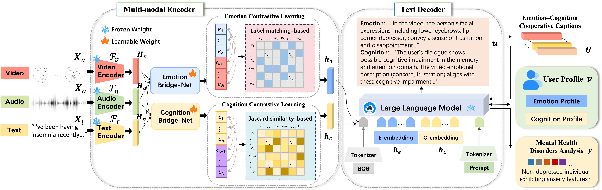

# Voices, Faces, and Feelings: Multi-modal Emotion-Cognition Captioning for Mental Health Understanding *(AAAI 2026)*  
---

## 🌟 Overview  
Understanding mental health disorders requires integrating both **emotional** and **cognitive** factors. However, existing multi-modal approaches often frame the task as simple classification, leading to limited interpretability—especially regarding the underlying emotional and cognitive mechanisms.  

To address these challenges, we propose **ECMC (Emotion–Cognition Multi-modal Captioning)**, a novel framework designed to generate **natural language descriptions** of emotional and cognitive states from **audio, visual, and textual** inputs. ECMC employs an **encoder–decoder architecture**, where modality-specific encoders are connected through a **dual-stream BridgeNet** based on Q-former. This design enables fine-grained emotion–cognition feature fusion, further enhanced via **contrastive learning**. A **LLaMA-based decoder** then aligns these features with annotated captions to produce interpretable emotion–cognition descriptions and profiles.  

Extensive objective and subjective evaluations demonstrate that ECMC not only **outperforms existing multi-modal LLMs and mental health models** in caption generation, but also **enhances diagnostic interpretability** by bridging perceptual cues and psychological reasoning.

<p align="center">
  
</p>
<p align="center"><b>Figure 1.</b> The framework of the proposed method.</p>

## Data Availability

Due to privacy and ethical considerations, the dataset used in this work cannot be publicly released or redistributed through this repository.
The data were obtained from the **MMDA** dataset. Researchers interested in accessing the dataset are advised to contact the original MMDA authors regarding data availability and access procedures.For further details, please refer to the original MMDA paper:

[MMDA: Multimodal Dataset for Depression Analysis](https://dl.acm.org/doi/10.1007/978-3-031-37660-3_49)


## Erratum

We identified an error in the CIDEr scores reported in **Table 1** and **Table 2** of the published paper. The CIDEr values were incorrectly reported and duplicated the corresponding BLEU-4 scores. The corrected tables are provided below. All other metrics remain unchanged. This correction does not affect the comparisons, findings, or conclusions of the paper.

### Table 1. Comparison of emotion captioning performance with other methods

| Method | Modality | Domain | BLEU-1 | BLEU-2 | BLEU-4 | METEOR | ROUGE-L | CIDEr | F_BERT |
|---|---|---|---:|---:|---:|---:|---:|---:|---:|
| InternVL-2.5-8B | VT | General | 8.35 | 3.30 | 0.96 | 10.06 | 13.98 | 0.61 | 6.48 |
| DeepSeek-VL-2-small | VT | General | 2.98 | 1.33 | 0.42 | 5.99 | 10.00 | 0.52 | 2.02 |
| Sa2VA-8B | VT | General | 14.36 | 7.05 | 2.14 | 15.35 | 20.34 | 1.64 | 12.28 |
| Qwen2.5-Omni-7B | AVT | General | 12.74 | 4.86 | 1.42 | 13.31 | 16.99 | 0.81 | 8.93 |
| PsycoLLM | T | Mental | 4.86 | 1.76 | 0.50 | 5.68 | 7.68 | 0.40 | 0.35 |
| MindChat | T | Mental | 5.44 | 1.75 | 0.50 | 6.73 | 9.71 | 0.67 | 0.87 |
| EmoLLM | T | Mental | 8.50 | 3.50 | 1.19 | 10.08 | 14.25 | 0.74 | 6.25 |
| CPsyCoun | T | Mental | 17.44 | 7.24 | 1.93 | 15.07 | 18.90 | 2.33 | 9.30 |
| **Ours** | **AVT** |  | **34.76** | **19.40** | **8.28** | **29.47** | **24.91** | **6.29** | **27.13** |

### Table 2. Comparison of cognition captioning performance with other methods

| Method | Modality | Domain | BLEU-1 | BLEU-2 | BLEU-4 | METEOR | ROUGE-L | CIDEr | F_BERT |
|---|---|---|---:|---:|---:|---:|---:|---:|---:|
| InternVL-2.5-8B | VT | General | 8.17 | 3.05 | 0.84 | 9.35 | 16.52 | 0.91 | 18.43 |
| DeepSeek-VL-2-small | VT | General | 8.49 | 4.40 | 1.72 | 10.34 | 15.45 | 0.52 | 6.75 |
| Sa2VA-8B | VT | General | 15.82 | 6.24 | 1.61 | 13.15 | 22.59 | 1.23 | 18.78 |
| Qwen2.5-Omni-7B | AVT | General | 12.82 | 5.30 | 1.48 | 12.04 | 19.56 | 1.19 | 20.03 |
| PsycoLLM | T | Mental | 6.22 | 3.19 | 1.30 | 10.59 | 10.48 | 1.43 | 6.60 |
| MindChat | T | Mental | 6.81 | 3.02 | 1.11 | 8.33 | 11.74 | 0.67 | 5.41 |
| EmoLLM | T | Mental | 17.00 | 6.66 | 1.98 | 13.29 | 19.08 | 1.78 | 14.99 |
| CPsyCoun | T | Mental | 9.32 | 3.89 | 1.06 | 18.88 | 23.07 | 0.51 | 4.47 |
| **Ours** | **AVT** |  | **35.92** | **25.05** | **15.32** | **35.86** | **39.82** | **6.50** | **41.04** |

We apologize for the error and any confusion it may have caused.

## Citation

If you find this work useful or inspiring for your research, please consider citing our paper:

> Zhou, Z., Guo, Y., & Hao, S. (2026).  
> **Voices, Faces, and Feelings: Multi-modal Emotion-Cognition Captioning for Mental Health Understanding.**  
> *Proceedings of the AAAI Conference on Artificial Intelligence*, *40*(3), 2263–2271.  
> https://doi.org/10.1609/aaai.v40i3.37210

BibTeX:

```bibtex
@inproceedings{zhou2026voices,
  title     = {Voices, Faces, and Feelings: Multi-modal Emotion-Cognition Captioning for Mental Health Understanding},
  author    = {Zhou, Zhiyuan and Guo, Yuting and Hao, Shuang},
  booktitle = {Proceedings of the AAAI Conference on Artificial Intelligence},
  volume    = {40},
  number    = {3},
  pages     = {2263--2271},
  year      = {2026},
  doi       = {10.1609/aaai.v40i3.37210}
}
